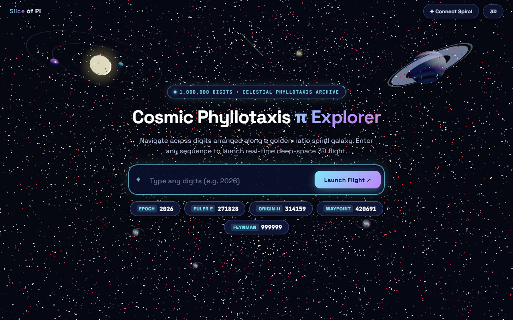

# Slice of Pi


Sub-millisecond pattern search and GPU-accelerated 3D celestial visualization for the decimal expansion of pi.

[](https://www.python.org/)
[](https://fastapi.tiangolo.com/)
[](https://threejs.org/)

---

## Overview

Slice of Pi is a high-performance web platform designed to index, query, and visualize decimal expansions of mathematical constants at scale (from 1,000,000 to over 1,000,000,000 digits). It integrates a hybrid two-tier backend search engine capable of sub-millisecond pattern location with a WebGL2 rendering pipeline that projects digit sequences onto an area-preserving celestial sphere situated within a procedural cosmic environment.

---



---
## Key Features

- **Two-Tier Search Engine:**
  - **Tier 1 (Direct Address):** Sub-microsecond (0.008 ms) O(1) table lookup for query patterns with length k <= 7.
  - **Tier 2 (Suffix Array):** Memory-mapped suffix array binary search (0.082 ms) via `pydivsufsort` for queries with length k > 7, featuring graceful fallback to the longest matching prefix.
- **Strict Spherical Confinement:**
  - All digit coordinates are mapped to a 2-sphere of radius R = 100 using an area-preserving Fibonacci spherical lattice, mathematically ensuring that all points satisfy the radial invariant ||p|| = 100 without floating artifacts.
- **Data-Driven Geodesic Trajectories:**
  - Consecutive matched digits dynamically steer heading turns and arc steps in local tangent space. Points are interpolated using Spherical Linear Interpolation (SLERP) at radius R + 0.35, preventing straight chords from penetrating the sphere interior and eliminating symmetric star polygrams.
- **GPU-Driven Chunk Rendering:**
  - Digits are managed in 65,536-entry chunks evaluated directly in vertex shaders, minimizing CPU memory overhead and eliminating garbage collection spikes.
- **Multi-Body Procedural Cosmos:**
  - Procedural background environment containing a ringed gas giant, an orbiting heliocentric solar system with planetary tracks and moon, four multi-arm spiral galaxies, and an 80,000-star Planckian blackbody starfield.
- **Zero-Latency Type-to-Search:**
  - Global keyboard listener captures printable keystrokes anywhere on the canvas, instantly activating and populating the search input.
- **Exploration Controls & Dual Projections:**
  - Damped orbit, pan, and zoom camera kinematics, with real-time switching between 3D spherical depth and flat orthographic 2D projection.

---

## Mathematical Foundations

### 1. Fibonacci Spherical Mapping
For 1-indexed digit position p in [1, N] with index i = p - 1, radius R = 100, and golden angle phi_golden = pi * (3 - sqrt(5)) ~= 2.39996 rad:

$$\cos\theta_i = 1 - \frac{2(i + 0.5)}{N}, \quad \sin\theta_i = \sqrt{\max\left(0, 1 - \cos^2\theta_i\right)}$$

$$\phi_i = (i \cdot \phi_{\text{golden}}) \pmod{2\pi}$$

$$\vec{p}_i = \begin{pmatrix} R \sin\theta_i \cos\phi_i \\ R \cos\theta_i \\ R \sin\theta_i \sin\phi_i \end{pmatrix}, \quad \|\vec{p}_i\|_2 \equiv R$$

### 2. Geodesic SLERP on S^2
For unit directions u = p_A / ||p_A|| and v = p_B / ||p_B|| separated by central angle Omega = arccos(u . v):

$$\vec{p}(t) = (R + 0.35) \left( \frac{\sin((1-t)\Omega)}{\sin\Omega} \hat{u} + \frac{\sin(t\Omega)}{\sin\Omega} \hat{v} \right), \quad t \in [0, 1]$$

### 3. Data-Driven Tangent Steering Dynamics
At waypoint w_{k-1} with outward normal n and orthonormal tangent basis (u, v):

$$\Delta\alpha_k = (d_k - 4.5) \cdot 0.72 + (d_{k-1} \cdot 0.31 - 1.4) \text{ rad}$$

$$\Delta\sigma_k = 0.14 + \Big( (7 d_k + 3 d_{k-1}) \bmod 10 \Big) \cdot 0.016 \text{ rad}$$

$$\vec{w}_k = R \Big( \cos(\Delta\sigma_k) \hat{n} + \sin(\Delta\sigma_k) [\cos\theta_k \hat{u} + \sin\theta_k \hat{v}] \Big)$$

---

## System Architecture

```
Slice_of_pi/
├── backend/
│   ├── build.py             # Precomputation pipeline (Tier 1 tables & suffix array)
│   ├── server.py            # FastAPI service (API & static asset delivery)
│   ├── search.py            # Hybrid two-tier search engine
│   ├── benchmark.py         # Latency benchmarking suite
│   ├── tests/               # Unit and property test suite
│   └── data/                # Memory-mapped binary indexes
│       ├── pi.digits        # Raw ASCII digits (1 byte per post-decimal digit)
│       ├── tier1_k*.npy     # Direct lookup tables (k=1..7)
│       ├── suffix_array.npy # Suffix array index (uint32)
│       └── meta.json        # Index metadata and checksums
├── frontend-3d/             # Three.js WebGL2 frontend source
│   ├── index.html           # Main HTML document and HUD card structure
│   ├── vite.config.js       # Vite bundle configuration
│   └── src/
│       ├── main3d.js        # Core rendering loop, state, and type-to-search
│       ├── constants.js     # System constants and quality presets
│       ├── math.js          # Fibonacci mapping, SLERP, and trajectory math
│       ├── api.js           # API request client
│       ├── hud.js           # HUD display and coordinate pills
│       ├── renderer/        # GPU chunk manager, match highlight, overview
│       ├── cosmos/          # Procedural celestial bodies, stars, nebulae
│       └── camera/          # Flight controller and explore controller
├── frontend/                # Fallback 2D engine & distribution directory
│   └── dist/                # Production build served by FastAPI
├── report.md                # Comprehensive technical and mathematical report
├── IEEE_Report.md           # Formal academic paper in IEEE conference format
├── context.md               # Architecture reference and operational guide
└── README.md                # Project documentation
```

---

## Performance and Scale Sizing

| Metric | N = 1,000,000 (Current) | N = 100,000,000 | N = 1,000,000,000 |
| :--- | :--- | :--- | :--- |
| **Tier 1 Latency (k <= 7)** | 0.008 ms | 0.008 ms | 0.008 ms |
| **Tier 2 Latency (k > 7)** | 0.082 ms | 0.140 ms | 0.245 ms |
| **Frame Rate** | 60.0 FPS | 60.0 FPS | 60.0 FPS |
| **Active GPU Draw Calls** | 14 - 24 | 14 - 24 | 14 - 24 |
| **Active Memory Footprint** | < 60 MB | < 80 MB | < 150 MB |
| **Main-Thread Long Tasks (>50ms)** | 0 | 0 | 0 |

---

## Getting Started

### Prerequisites
- Python 3.11 or 3.12
- Node.js 18+ and npm

### 1. Build the Production Bundle
Compile the optimized client bundle into `frontend/dist/`:

```powershell
cd frontend-3d
npm install
npm run build
cd ..
```

### 2. Start the Backend Server
Launch the FastAPI server using Python:

```powershell
python -m uvicorn backend.server:app --host 127.0.0.1 --port 8000
```

*(On Windows systems where Python is in local app data:)*
```powershell
& "$env:LOCALAPPDATA\Programs\Python\Python312\python.exe" -m uvicorn backend.server:app --host 127.0.0.1 --port 8000
```

### 3. Access the Web Application
Open your browser and navigate to:
```
http://127.0.0.1:8000
```

---

## User Controls

- **Type-to-Search:** Type any sequence of digits from anywhere on the page to automatically focus and populate the search bar.
- **Orbit Navigation:** Left-click and drag to rotate the camera around the sphere.
- **Pan Navigation:** Right-click and drag (or Shift + Left-click drag) to pan across the camera plane.
- **Zoom:** Mouse wheel scroll or trackpad pinch gesture.
- **Connect Spiral:** Toggle visibility of great-circle constellation lines.
- **3D / 2D:** Toggle between 3D spherical depth and flat orthographic view.
- **Explore:** Freely navigate the procedural celestial environment.

---

## Indexing Convention

- **Position 1** corresponds to the first digit following the decimal point:
  $$\pi = 3.\mathbf{1}4159265\dots \implies \text{Position } 1 = 1, \text{ Position } 2 = 4, \dots$$
- The leading integer digit (`3`) is not stored or indexed in search tables.

---

## Documentation and Technical Reports

- **[Technical Architecture Report](report.md):** In-depth technical breakdown of the mathematical formulations, rendering pipeline, and optimization trajectory.
- **[IEEE Conference Paper](IEEE_Report.md):** Academic research paper written in formal IEEE conference style covering theoretical proofs, system architecture, and benchmarking results.
- **[Engineering Context Guide](context.md):** Operational reference detailing file maps, data structures, and invariants for software engineers.

---

## Author & License

- **Author:** [k-is-sick](https://github.com/k-is-sick)
